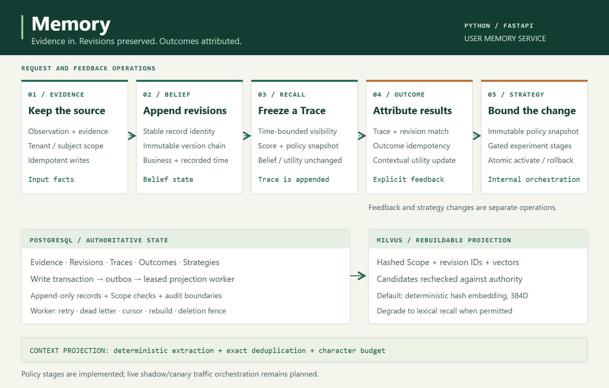
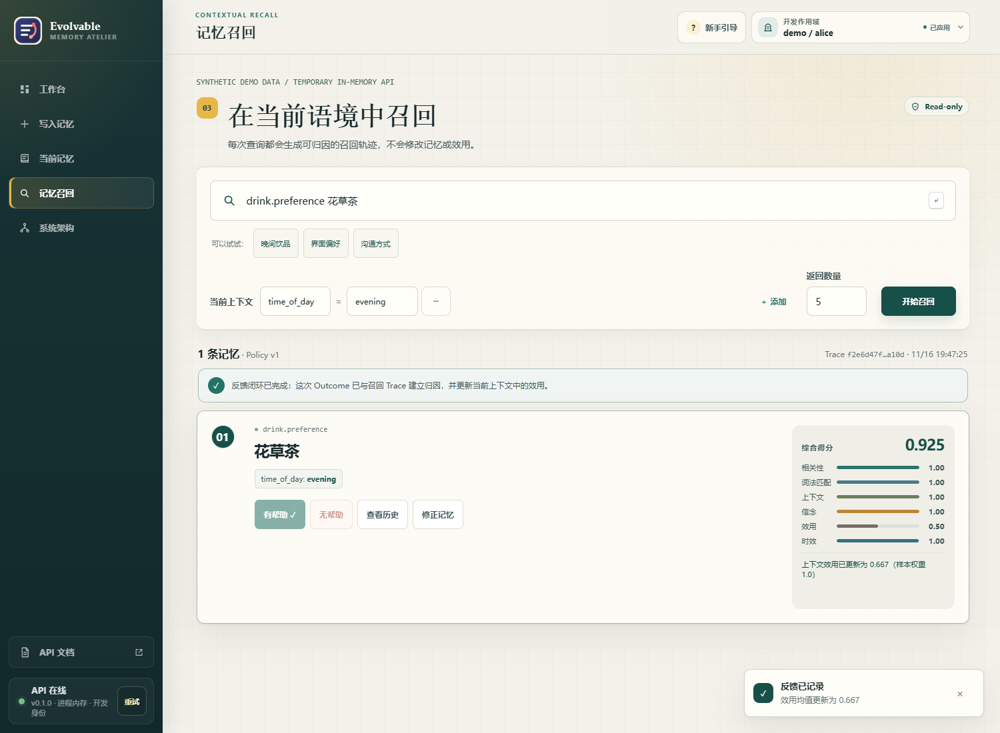
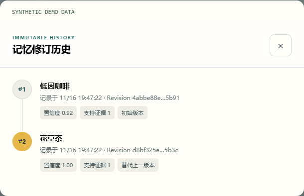

# Memory

**让 Agent 的记忆有依据、可修正，也能从结果中学习。**

[](https://github.com/AoHanBei/Memory/actions/workflows/ci.yml) [](LICENSE)

Memory 是基于 Python / FastAPI 的用户记忆服务，为 AI 应用管理输入证据、不可变修订、
双时间召回和结果反馈。PostgreSQL 保存权威状态，Milvus 提供可重建的向量投影。

每次召回会记录命中版本、评分和策略；应用反馈必须归因到对应 Trace，才能更新上下文效用。
**召回不改变信念或效用，但会追加不可变 RecallTrace。**

`0.1.x` 为开发预览版，面向本机体验与集成验证。

[快速开始](#快速开始) · [记忆闭环](#从一条偏好看记忆闭环) · [工作台](#查看实际工作台) · [文档](docs/index.md)



## 从一条偏好看记忆闭环

以晚间饮品偏好为例，演示数据按下面的顺序流转：

| 操作 | 系统保留什么 | 可以检查什么 |
| --- | --- | --- |
| 写入“晚上喝低因咖啡” | Observation、EvidenceSpan 和第一条 Revision | 信念来自哪段证据 |
| 修正为“晚上改喝花草茶” | 追加新 Revision，保留旧版本 | 当前状态和完整修订链 |
| 按时间与上下文召回 | 命中版本、评分拆解和不可变 Trace | 当时有效且系统已知的记忆 |
| 提交有帮助／无帮助反馈 | 归因到 Trace 和 Revision 的 Outcome | 哪次使用带来了什么结果 |
| 检查策略提案 | 有界参数与持久化阶段记录 | 哪些参数可以调整、哪些规则保持固定 |

[记忆生命周期与代码证据](docs/memory-lifecycle.md)串起这些对象，并列出代表性测试。

## 五个核心机制

| 机制 | 当前实现 | 代码入口 |
| --- | --- | --- |
| 证据与不可变修订 | Scope 内幂等写入；同值强化和异值修正遵循明确规则；历史版本保留。 | [领域记忆](src/evolvable_memory/domain/memory.py)、[用例编排](src/evolvable_memory/application/service.py) |
| 双时间召回 | `valid_at` 指业务时点，`known_at` 限制系统当时已知的信息。 | [召回服务](src/evolvable_memory/application/service.py) |
| 可解释检索与上下文投影 | 词法／Milvus 候选经权威存储复核；Trace 冻结评分，投影按字符预算排序抽取与精确去重。 | [Milvus](src/evolvable_memory/adapters/milvus.py)、[上下文投影](src/evolvable_memory/application/compression.py) |
| Outcome 效用归因 | 反馈关联已召回的 Revision；只有可归因 Outcome 才学习上下文效用。 | [经验对象](src/evolvable_memory/domain/experience.py)、[用例编排](src/evolvable_memory/application/service.py) |
| 有界策略更新 | 不可变策略快照、实验阶段、Gate Receipt 和原子晋升／回滚；权限、隔离、删除与审计规则固定。 | [策略领域](src/evolvable_memory/domain/evolution.py)、[演化编排](src/evolvable_memory/application/evolution.py) |

## 查看实际工作台

当前记忆、修订历史和召回评分可以在独立 Web 工作台查看。
下面使用本仓库前端和真实的临时内存 API，数据为文档专用合成偏好。



<details>
<summary>展开查看不可变修订历史</summary>



</details>

截图反映本机演示流程，生成方式和来源记录见[素材说明](docs/assets/README.md)。

## 快速开始

需要 Python 3.12+ 和 [uv](https://docs.astral.sh/uv/)。

```bash
git clone https://github.com/AoHanBei/Memory.git
cd Memory
uv sync --locked
```

终端 A 启动 API：

```bash
uv run evolvable-memory
```

终端 B 启动工作台：

```bash
uv run evolvable-memory-frontend
```

打开 [工作台](http://127.0.0.1:33009)，按五步引导完成写入、列表、召回与反馈，
再尝试追加修正。接口文档位于 [Swagger UI](http://127.0.0.1:38089/docs)。

```bash
curl http://127.0.0.1:38089/health
uv run python examples/first_memory.py
```

| 运行方式 | 权威存储与检索 | 数据保留 |
| --- | --- | --- |
| 原生双进程（以上命令） | 内存存储、词法召回 | API 进程结束后清空 |
| 默认 Docker Compose | PostgreSQL、Milvus 和独立投影 worker | 保存在命名 volume |

需要持久化演示环境时运行 `docker compose up --build -d`，详细步骤见
[部署指南](docs/deployment.md)。默认离线向量为 **384 维确定性哈希 embedding**；
可配置 OpenAI-compatible embedding，相关性与模型选择应单独评估。

## 运行内置评测门禁

```bash
uv run evolvable-memory-eval run --dataset builtin:smoke-v1
uv run evolvable-memory-eval run --dataset builtin:temporal-v1
```

两个合成契约集在隔离内存中检查召回、更新、双时间、归因、拒绝和 Scope 隔离。
Recall@k、MRR 等硬门禁用于项目回归验证；真实场景质量需要代表性数据单独评估。
指标、数据集和失败排查见[评测指南](docs/evaluation.md)。

## 架构与代码结构

依赖方向为 `bootstrap → api / adapters → application → domain`，领域层保持纯 Python。
完整结构、事务与不变量见[架构说明](docs/architecture.md)。

## 开发与质量检查

```bash
uv run ruff check .
uv run ruff format --check .
uv run mypy
uv run pytest
uv build
```

数据库、浏览器和可访问性检查的前置条件见[开发指南](docs/development.md)。

## 配置

环境变量表见[配置参考](docs/configuration.md)，示例见 [.env.example](.env.example)。
前后端通过 `EMF_PUBLIC_API_URL` 使用一致的 API 地址；应用不会自动加载 `.env`。

## 当前边界

- 双时间查询重建历史可见状态，评分使用执行时策略。完整历史策略与运行环境重放待实现。
- 策略实验支持阶段持久化与受控激活；真实 shadow/canary 流量编排仍是后续工作。
- JWT、授权与在线删除已有实现；完整 IdP 治理、RLS、自动保留、备份治理和生产 SLO 仍需完善。

详细合同和状态见[运行边界](docs/runtime-scope.md)、[安全政策](SECURITY.md)及[路线图](ROADMAP.md)。

## 文档导航

| 任务 | 文档 |
| --- | --- |
| 跑通第一条闭环 | [快速开始](docs/getting-started.md)、[前端工作台](docs/frontend-guide.md) |
| 查看 API 与业务机制 | [API](docs/api-guide.md)、[生命周期](docs/memory-lifecycle.md)、[架构](docs/architecture.md) |
| 配置存储与向量投影 | [部署](docs/deployment.md)、[Milvus 投影](docs/milvus-projection.md)、[配置](docs/configuration.md) |
| 评测或调整策略 | [评测](docs/evaluation.md)、[演化安全](docs/evolution-safety.md) |
| 维护授权与隐私生命周期 | [身份与权限](docs/authorization.md)、[治理运行手册](docs/governance.md)、[数据生命周期](docs/data-lifecycle.md) |

全部文档见[文档索引](docs/index.md)。

## 项目背景与许可

项目由 [AoHanBei](https://github.com/AoHanBei) 维护。个人实践背景、AI 辅助开发方式
与测试工具来源见[项目背景](PROVENANCE.md)。

采用 **AGPL-3.0-only**，详见 [LICENSE](LICENSE)。
